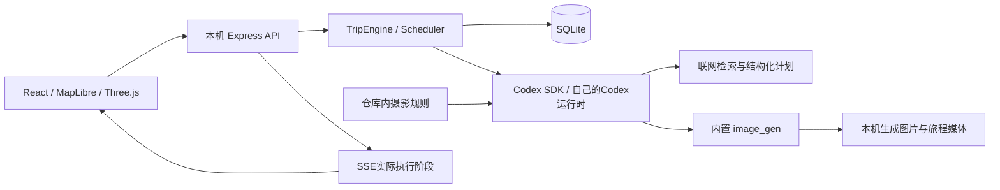

# 架构与独立运行

浏览器以同源方式连接本地 Express 服务，服务通过 Codex SDK 创建独立任务会话；SQLite 保存每段旅程，图片按旅程存入本地媒体目录。

## 原型保留的行为

- 初始计划、下一节点、照片、相册分别执行。每站有 4/9 个拍摄时刻，最多同时生成两张。
- 计划保留 visited / skipped / superseded，意外可以改写未完成路线。
- 开放后果逐站更新，旅伴身份及关系有持续账本。
- 慢时钟和事件时钟使用相同引擎；事件时钟等整组照片完成再继续，失败时停止自动推进。
- 暂停和结束后，未保存的迟到结果不能重新激活旅程；照片失败可重试。
- SSE只公开操作阶段与结果状态，不公开模型推理、工具参数和命令正文。
- 三维相册使用分段纸张网格与提前缓存的页面纹理，拖动中可看见下一页。

## 从作者环境解除的依赖

- 不引用其他内容生产工程、桌面媒体或作者机器的绝对路径。
- 不读取作者私人 Skill 目录。默认规则随仓库分发；自定义资料目录显式可选。
- 不携带原始 SQLite、照片、会话、登录或环境文件；不搬运原项目 Git 历史。
- 图像能力仍通过使用者自己的 Codex 提供。不能把单个账号的模型权限、额度或工具可用性复制给别人。
- SDK和所有Web依赖使用 lockfile；Node版本固定为24主版本。

地图、代理、存储和导出均运行在独立仓库内。AI服务、联网地图和Codex登录是外部前置条件；不提供离线模型或共享云后端。
